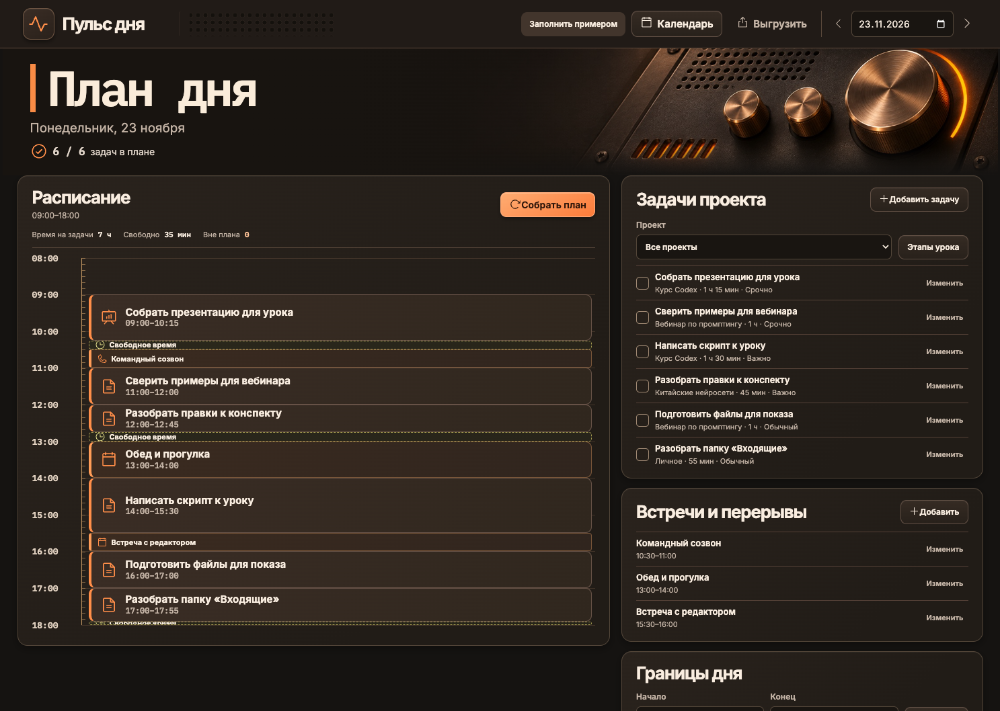
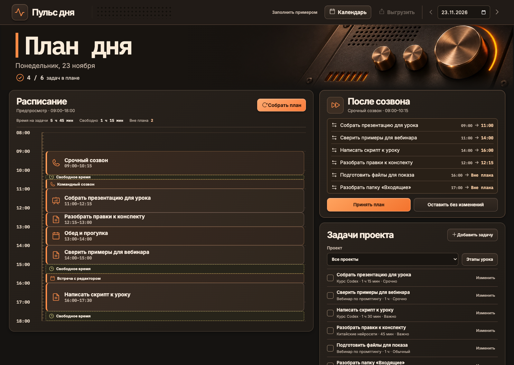

# Пульс дня

Личный планировщик для работы над несколькими проектами. Собирает день вокруг фиксированных встреч, учитывает приоритеты и порядок задач. Показывает, что не помещается в оставшиеся интервалы, и помогает перенести задачи на завтра.

## Как открыть

1. Скачайте и распакуйте архив версии.
2. В распакованной папке откройте `index.html` в современном браузере. Для первого запуска подойдёт Chrome.
3. Нажмите **Заполнить примером**, чтобы увидеть готовый день, или добавьте собственные встречи и задачи и нажмите **Собрать план**.

Приложение запускается без сервера, аккаунта, установки зависимостей и интернета. План хранится локально в текущем браузере. Данные открытого с диска файла и онлайн-версии хранятся отдельно. Файл `.ics` можно импортировать в календарь как снимок расписания на выбранный день.

## Попробуйте

- Выберите проект в списке задач. Расписание по-прежнему учитывает все проекты.
- Нажмите **Этапы урока** и введите название. Появятся связанные задачи: презентация, скрипт, запись и конспект.
- В готовом примере добавьте **Срочный созвон** с 09:00 до 10:15. Карточка «После созвона» покажет прежнее и новое время задач. В примере помещаются четыре задачи из шести. Нажмите «Принять план» и при необходимости перенесите два дела на завтра. Кнопка «Оставить без изменений» возвращает исходное расписание.
- Перейдите стрелкой к следующему дню и проверьте перенесённые задачи. Для связанных незаконченных этапов приложение предложит перенос группы.
- Нажмите **Скачать .ics** и импортируйте файл в отдельный календарь для проверки.

Кнопки внизу страницы сохраняют резервную копию планов в JSON и восстанавливают её. Это пригодится, если вы переносите данные в другой браузер.

## Файлы

- `index.html` — интерфейс и точка входа.
- `styles.css` — оформление, включая узкий экран.
- `app.js` — расчёт плана, локальное хранение и экспорт календаря.
- `docs/` — скриншоты рабочего сценария.

Расписание выбирает первый подходящий целый интервал, учитывая приоритет и порядок задач. Длинные задачи остаются цельными. Пользователь может сам разбить их на части или отложить. Планы не синхронизируются между браузерами и устройствами.

## Встречи и форматы выгрузки

Откройте **Календарь и встречи** и выберите период начиная с даты плана. Можно загрузить отдельный файл `.ics`, CSV/TSV с колонками **Дата, Начало, Конец, Название** или вставить список вида `10:30–11:15 Встреча с редактором`. Строки без даты относятся к выбранному дню. Из Google Календаря экспортируйте события на компьютере через **Настройки → Импорт и экспорт → Экспорт**. Если Google выдал ZIP, сначала распакуйте его и выберите нужный ICS. [Справка Google об экспорте](https://support.google.com/calendar/answer/37111?hl=ru)

После предварительного просмотра нажмите **Добавить в план**. Встречи становятся занятыми интервалами. У каждой можно нажать **Исключить** и освободить время. Повторная загрузка той же встречи с тем же названием и временем не создаёт ещё одного блока.

В меню **Выгрузить план**:

- **PDF или печать** — удобная версия расписания с задачами, которые не поместились. В окне печати выберите сохранение в PDF.
- **Таблица CSV** — файл с названием, временем, статусом и проектом для Excel или Google Таблиц.
- **В календарь · ICS** — события дня, которые можно импортировать в календарь. Уже загруженные встречи пропускаются при этой выгрузке. [Импорт событий в Google Календарь](https://support.google.com/calendar/answer/37118?hl=ru)

## Подключение основного Google Календаря

Подключение читает занятые события за выбранный период. Чтобы получить изменения календаря, откройте раздел снова, нажмите **Загрузить встречи** и подтвердите **Обновить встречи Google**. Для записи в календарь используйте отдельную выгрузку ICS. Токен доступа хранится только до перезагрузки страницы. В браузере остаются добавленные в план названия и время встреч и публичный OAuth Client ID.

### Настройка один раз

1. Откройте «Пульс дня» по HTTPS, например по итоговой ссылке GitHub Pages. Для локального подключения на Mac можно открыть Терминал в папке приложения, выполнить `python3 -m http.server 8765 --bind 127.0.0.1` и перейти на `http://localhost:8765`. Для запуска команды нужен Python 3. При переезде с файла на новый адрес перенесите планы кнопками резервной копии.
2. В Google Cloud создайте или выберите проект и включите **Google Calendar API**. В **Google Auth platform** настройте **Branding** и **Audience**. Для личного подключения в режиме тестирования добавьте себя в **Test users**. В **Data Access** добавьте область `https://www.googleapis.com/auth/calendar.events.readonly`.
3. В **Clients** создайте клиент типа **Web application**. В **Authorized JavaScript origins** добавьте только источник сайта без пути, например `https://username.github.io`. Для локального запуска добавьте `http://localhost` и `http://localhost:8765`. Скопируйте **Client ID**.
4. В приложении откройте **Календарь и встречи → Google Календарь**, вставьте Client ID и нажмите **Подключить и загрузить**. Выберите свой аккаунт в окне Google и предоставьте доступ на чтение. Сверьте предварительный список и подтвердите загрузку.

[Настройка OAuth-клиента для браузера](https://developers.google.com/identity/oauth2/web/guides/get-google-api-clientid) · [Включение Calendar API](https://developers.google.com/workspace/guides/enable-apis)

## Состав версии 1.3.0

`calendar-tools.js` отвечает за импорт, выгрузки и чтение Google Календаря. `vendor/` содержит ICAL.js 2.2.1 с лицензией MPL-2.0. [Исходники ICAL.js](https://registry.npmjs.org/ical.js/-/ical.js-2.2.1.tgz).

### Иллюстрация и шрифты

`assets/console-dials.jpg` создан генератором изображений и входит в офлайн-комплект. В интерфейсе используются Inter, IBM Plex Mono и набор иконок Phosphor. Лицензии лежат рядом с файлами в `assets/`. Анимация учитывает системную настройку уменьшения движения.
